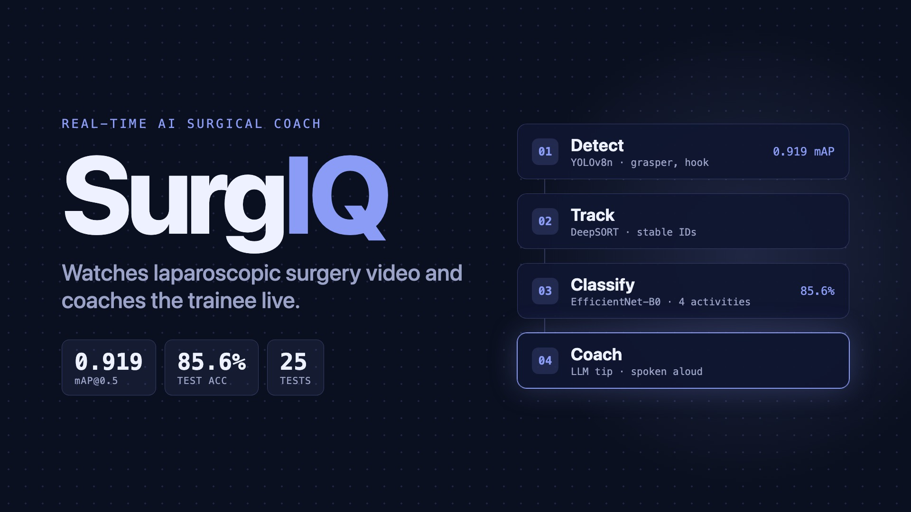

# 🔬 SurgIQ

**A real-time AI coach for laparoscopic surgery training.**

SurgIQ is a computer-vision pipeline that watches laparoscopic cholecystectomy (gallbladder removal) video as it plays. On every frame it finds the surgical instruments, tracks each one with a stable ID, and classifies what the surgeon is doing. When the activity changes, an LLM writes a short coaching tip for the trainee, and it can be read aloud so the surgeon never has to look away. Results stream over Redis to a live Streamlit dashboard.

    

## Demo video

[](assets/surgiq-demo.mp4)

**[▶ surgiq-demo.mp4](assets/surgiq-demo.mp4)**: 40 seconds, all real. It shows `main.py` running on a laparoscopic clip, live YOLOv8n boxes with the activity label on each frame, results streaming to the dashboard, a fresh coaching tip from the LLM read aloud, and the session summary.

## Try it

There's no hosted demo, because the pipeline needs the trained weights and a GPU-friendly machine. It runs locally in three terminals (see [Run it locally](#run-it-locally)):

1. Start Redis, then the pipeline on any laparoscopic video: `python main.py --source surgery.mp4 --session-id demo`
2. Open the dashboard: `streamlit run dashboard/app.py`
3. Watch the activity label, the track IDs and the coaching tips update live. Turn on **🔊 Voice coaching** to hear each new tip.

Each activity label gives the LLM different context, so the coaching changes with what's on screen. These two tips are real outputs from the run in the demo video (2026-10-20, `openai/gpt-oss-120b`):

| Activity | Example coaching tip |
|---|---|
| `hook_only` | "Maintain a shallow, sweeping motion with the L‑hook, keeping the tip just 1–2 mm from the tissue to cut while the jaws stay closed for coagulation. Constantly visualize the cystic plate and avoid prolonged activation; brief bursts (≤2 seconds) reduce thermal spread and protect the bile duct." |
| `grasper_only` | "Maintain a gentle, steady traction with the grasper—just enough to expose Calot's triangle without compressing the cystic structures. Keep the instrument tip pointed toward the target tissue and avoid pulling too hard, which can tear the gallbladder or cause bleeding." |

## How it works

```
Video / webcam ─▶ VideoProcessor ─▶ YOLOv8n detector ─▶ DeepSORT tracker
                    (5 FPS)          (Grasper · Hook)     (stable IDs)
                                                              │
   Streamlit dashboard ◀── Redis Streams ◀── LLM coach ◀── EfficientNet-B0
   (live charts, voice)     (pub / sub)      (Groq)        (4 activity classes)
```

- **Frames** (`pipeline/video_processor.py`). Reads a video file or a webcam index with OpenCV and yields frames at 5 FPS, skipping frames to match the source's native rate (every 6th frame of a 30 FPS video).
- **Detect** (`pipeline/instrument_detector.py`). A fine-tuned YOLOv8n finds the two instruments, Grasper and Hook (confidence threshold 0.25, IoU 0.45). It runs on Apple Silicon through MPS, on CUDA, or on CPU, whichever is available.
- **Track** (`pipeline/instrument_tracker.py`). DeepSORT, from `deep-sort-realtime` with a MobileNet appearance embedder, gives each instrument an ID that stays the same across frames, even through brief occlusions. A track is confirmed after 3 hits and kept alive for 30 frames.
- **Classify** (`pipeline/technique_classifier.py`). A fine-tuned EfficientNet-B0 (224 px input) labels each frame as `no_instrument`, `grasper_only`, `hook_only` or `both_instruments`.
- **Coach** (`pipeline/feedback_generator.py`). Groq's `openai/gpt-oss-120b` writes a 2–3 sentence tip from the current activity and the active tracks. It's called at most once every 5 seconds, and only when the label changes. The call runs in a background thread, so a slow API response never stalls the video. Without a `GROQ_API_KEY` it falls back to placeholder text.
- **Voice** (`pipeline/voice_feedback.py`, `--voice`). Speaks the first two sentences of each tip with macOS `say` in a background thread. The dashboard has its own toggle that uses the browser's Web Speech API.
- **Stream** (`pipeline/redis_producer.py`, `pipeline/redis_consumer.py`). Every frame's label, confidence, tracks and tip are published to the Redis Stream `surgiq:session:<id>`, trimmed to about the last 1,000 messages. If Redis isn't running, the producer quietly turns itself off and the pipeline keeps going.
- **Dashboard** (`dashboard/app.py`). A Streamlit app that polls the stream every 0.5 seconds. It shows the current activity badge with confidence, active tracks, frame number, pipeline FPS, the coaching box, an activity timeline and distribution chart (Plotly), an active-tracks table and a session summary, plus a session-ID field, a refresh-rate slider and a reset button.
- **Experiment tracking** (`mlops/mlflow_logger.py`). A small MLflow wrapper for logging training parameters, per-epoch metrics and artifacts.

## Evaluation

### Instrument detector: YOLOv8n

| Metric | Result |
|---|---|
| mAP@0.5 | **0.919** |
| Grasper AP@0.5 | **0.986** |
| Hook AP@0.5 | **0.851** |

The detector was trained on CholecSeg8k. The single biggest gain came from the labels: converting the pixel-level segmentation masks into one tight bounding box per instrument class (NumPy `argwhere`) lifted mAP@0.5 from 0.05 to 0.919.

### Activity classifier: EfficientNet-B0

| Metric | Result |
|---|---|
| Test accuracy (4,837 frames, 3 held-out videos) | **85.6%** |
| Validation accuracy (10 held-out videos) | **83.6%** |

Per class on the test set (`data/reports/classifier_metrics_test.json`):

| Class | Precision | Recall | F1 | Frames |
|---|---|---|---|---|
| `both_instruments` | 0.93 | 0.84 | 0.89 | 1,730 |
| `grasper_only` | 0.86 | 0.92 | 0.89 | 1,790 |
| `hook_only` | 0.74 | 0.89 | 0.81 | 678 |
| `no_instrument` | 0.80 | 0.67 | 0.72 | 639 |

The confusion matrix is in `data/reports/confusion_matrix_test.png`. The weakest class is `no_instrument`: about a third of those frames are called `grasper_only`.

> **Why the split matters.** Early experiments used only 17 videos and a frame-level split. They scored 94.7% validation accuracy but only 38% on unseen videos: neighbouring frames from the same video leaked between splits, and the model hadn't learned to handle different patients and lighting (domain shift). Retraining on all 80 Cholec80 videos with a video-level split, where no video appears in more than one split, brought test accuracy to 85.6%.

### Speed

| Measurement | Per frame |
|---|---|
| Detector (eval benchmark, `training/evaluate.py`) | 10.8 ms |
| Classifier (eval benchmark) | 7.8 ms |
| Detector + classifier | **18.6 ms** |
| End to end, including DeepSORT and the LLM (300-frame run, Apple Silicon, MPS) | **~145 ms (≈7 FPS)** |

The pipeline samples video at 5 FPS, so ~145 ms per frame keeps up in real time. The run recorded in the demo video measured 174 ms, because Redis, the dashboard and a screen recorder were running on the same machine.

Most of the end-to-end time is the tracker. Frames with no detections take about 16 ms, while frames with detections take about 200 ms, when DeepSORT computes an appearance embedding for each box. The LLM used to add 1–3 second freezes, until the call moved to a background thread:

| Same 300-frame clip | LLM call in the frame loop | LLM call in a background thread |
|---|---|---|
| Average per frame | 206 ms (4.8 FPS) | 145 ms (6.9 FPS) |
| Slowest frame | 1,887 ms | 383 ms |
| Frames over 1 second | 8 | 0 |

### Tests

25 unit tests (`tests/test_pipeline.py`) cover the config, the mask-to-bounding-box conversion, the activity-label logic, the detector, Redis publishing and reading, the feedback rate limiting and the video processor. All of them pass. GitHub Actions runs them on every push, along with a syntax check of every Python file and a Ruff lint.

## Dataset

Two public datasets of laparoscopic cholecystectomy video are used.

**CholecSeg8k** trains the detector: 17 video clips with pixel-level segmentation masks.

- Processed for YOLO: 5,619 train / 800 val / 1,280 test images.

**Cholec80** trains the classifier: 80 full videos with tool-presence labels at 1 FPS.

- Processed: 158,099 train / 21,562 val / 4,837 test frames.
- Video-level split: test = video48, video52 and video55; validation = video71–80; train = the other 67 videos.
- The 4 classes come from whether the Grasper and the Hook are present: `no_instrument`, `grasper_only`, `hook_only`, `both_instruments`.

## Project structure

```
config.py                  all paths, hyperparameters and constants
main.py                    pipeline orchestrator (CLI entry point)
pipeline/
  video_processor.py       frame extraction at 5 FPS
  instrument_detector.py   YOLOv8n inference + box drawing
  instrument_tracker.py    DeepSORT tracking
  technique_classifier.py  EfficientNet-B0 inference
  feedback_generator.py    rate-limited Groq LLM coaching
  voice_feedback.py        spoken tips (macOS say)
  redis_producer.py        Redis Streams publisher
  redis_consumer.py        Redis Streams consumer
dashboard/app.py           Streamlit real-time dashboard
training/
  prepare_dataset.py       CholecSeg8k masks → YOLO boxes
  prepare_cholec80.py      Cholec80 → classifier dataset (video-level split)
  train_detector.py        YOLOv8n fine-tuning
  train_classifier.py      EfficientNet-B0 fine-tuning (MPS / CUDA)
  evaluate.py              mAP, confusion matrix, latency benchmark
  colab_training.ipynb     Kaggle / Colab detector training notebook
mlops/mlflow_logger.py     experiment tracking
tests/test_pipeline.py     25 unit tests (pytest)
scripts/download_data.sh   dataset download helper
data/reports/              saved evaluation metrics and confusion matrices
assets/                    demo video + poster
.github/workflows/ci.yml   GitHub Actions: tests, coverage, lint
Dockerfile                 container image (CPU-only torch)
docker-compose.yml         Redis + pipeline + dashboard + MLflow
```

Raw and processed data (`data/raw/`, `data/frames/`, `data/processed/`) and model weights are git-ignored.

## Run it locally

You'll need Python 3.11+, Redis, a free [Groq API key](https://console.groq.com), and the two trained weight files.

```bash
git clone https://github.com/DEKU-12/Surgiq.git && cd Surgiq
python3 -m venv venv && source venv/bin/activate
pip install -r requirements.txt
cp .env.example .env    # then set GROQ_API_KEY
```

Put the trained weights here:

```
models/instrument_detector/best.pt              # YOLOv8n (from Kaggle training)
models/technique_classifier/technique_cnn.pth   # EfficientNet-B0
```

Run the full stack in three terminals:

```bash
brew services start redis                                  # 1 · Redis
python main.py --source surgery.mp4 --session-id demo      # 2 · pipeline
streamlit run dashboard/app.py                             # 3 · dashboard → http://localhost:8501
```

`main.py` options:

| Flag | What it does |
|---|---|
| `--source` | Video file path, or a webcam index such as `0` (default) |
| `--session-id` | Redis stream to publish to; must match the dashboard's Session ID (default `demo`) |
| `--no-redis` | Run standalone, printing to the console only |
| `--display` | Show the annotated video in an OpenCV window |
| `--voice` | Speak each coaching tip aloud (macOS) |
| `--max-frames N` | Stop after N frames |

Every frame prints a line with its latency, label, detections and track count. At the end you get the average latency and a breakdown of time spent in each activity.

### Training

```bash
# Classifier (runs on Apple Silicon or any GPU)
python training/prepare_cholec80.py --cholec80-dir ~/Downloads/cholec80
python training/train_classifier.py --epochs 30
python training/evaluate.py --split test
```

For the detector, open `training/colab_training.ipynb` on Kaggle with a T4 or P100 GPU. Training takes about an hour and saves `best.pt`.

### Tests

```bash
pytest tests/ -v --cov=pipeline --cov=training
```

## Docker

```bash
docker compose up --build
# Dashboard → http://localhost:8501
# MLflow    → http://localhost:5000
```

Compose starts four services: Redis, the pipeline, the dashboard and an MLflow server. Data and weights are mounted read-only from `./data` and `./models`. The pipeline service runs a 100-frame demo by default; change its `command` in `docker-compose.yml` to point at your own video. The image installs CPU-only PyTorch.

## Tech stack

| Layer | Choice |
|---|---|
| Instrument detection | YOLOv8n (Ultralytics) |
| Instrument tracking | DeepSORT (`deep-sort-realtime`, MobileNet embedder) |
| Activity classification | EfficientNet-B0 (PyTorch / torchvision) |
| LLM coaching | Groq API, `openai/gpt-oss-120b` |
| Voice | macOS `say`, browser Web Speech API |
| Message broker | Redis Streams |
| Dashboard | Streamlit + Plotly |
| Experiment tracking | MLflow |
| Containers | Docker + Docker Compose |
| CI | GitHub Actions (pytest, coverage, Ruff) |
| Training hardware | Apple M4 Pro (MPS), Kaggle T4 GPU, AWS g5.xlarge (A10G) |

## Data and disclaimer

CholecSeg8k and Cholec80 are public research datasets and belong to their authors; follow their licenses if you use them. SurgIQ is a training and research prototype. It is not a medical device and isn't meant for use in real surgery.

## Author

**Ayush Sudhir Meshram**, MS Data Science, George Washington University
[GitHub](https://github.com/DEKU-12) · [LinkedIn](https://linkedin.com/in/ayush-meshram)
